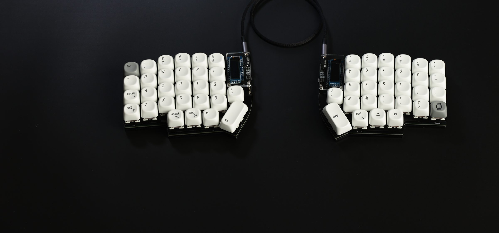
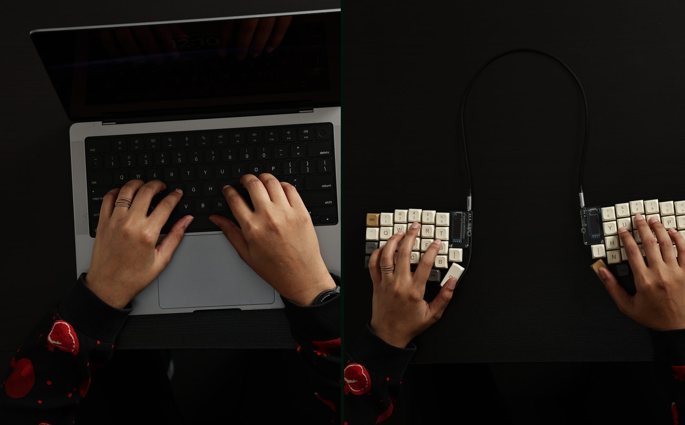

# Apollo58

**A split, column-staggered mechanical keyboard, made in India by [Reactiby Studio](https://reactibystudio.com).**



This repository holds everything that runs on an Apollo58: the firmware we ship, the VIA layout, guides for flashing and remapping, and every OLED experiment we made along the way.

**[Buy Apollo58 →](https://reactibystudio.com/products/apollo58)**

---

## The board

| | |
|---|---|
| Layout | 58 keys, split, columnar stagger, number row, 4-key thumb clusters |
| Displays | Two 128×32 OLEDs, one per half |
| Switches | Hot-swap sockets for any MX-style switch |
| Firmware | [QMK](https://qmk.fm), with [VIA](https://usevia.app) for remapping in the browser |
| Controller | Pro Micro (ATmega32U4), USB-C |
| Halves linked by | TRRS cable |

What the OLEDs show (firmware v1.3.0):

- **Left half:** the Apollo58 name, live typing speed (WPM), the active layer, Caps Lock, and which VIA macro just fired.
- **Right half:** every key you type falls down the screen like rain. Shift, Ctrl and Cmd/Windows fall as icons, and the Cmd or Windows icon is picked automatically for the computer you're plugged into.



## Quick links

| I want to… | Go to |
|---|---|
| See what every key does | [docs/layout.md](docs/layout.md) |
| Change keys, layers or macros | [docs/via.md](docs/via.md) |
| Install firmware, or reset the board | [docs/flashing.md](docs/flashing.md) |
| Fix a problem | [docs/troubleshooting.md](docs/troubleshooting.md) |
| Read the printed manual | [docs/Apollo58_User_Manual.pdf](docs/Apollo58_User_Manual.pdf) |
| Download the shipping firmware | [firmware/apollo58/apollo58-v1.3.0.hex](firmware/apollo58/apollo58-v1.3.0.hex) |
| Try a different OLED animation | [oled-themes/](oled-themes/) |

> ⚠️ **Never plug or unplug the TRRS cable while the keyboard is powered.** Unplug the USB-C cable first. Hot-plugging the TRRS can permanently damage a controller.

## What's in this repository

```
firmware/apollo58/   The firmware every Apollo58 ships with (source + ready-to-flash .hex)
firmware/via/        The shipping layout as a VIA file you can load or restore
oled-themes/         Earlier and alternative OLED animations, with source and .hex for each
archive/             Early test builds we keep for reference (no source)
docs/                Layout, VIA, flashing and troubleshooting guides, plus the user manual
images/              Photos used in this README
```

## Building from source

The firmware is a QMK keymap for `lily58/rev1`. With [QMK set up](https://docs.qmk.fm/newbs_getting_started):

```sh
cp -r firmware/apollo58 <qmk_firmware>/keyboards/lily58/keymaps/apollo58
qmk compile -kb lily58/rev1 -km apollo58
```

Any folder in `oled-themes/` builds the same way. See [firmware/apollo58/README.md](firmware/apollo58/README.md) for details.

## Support

- Warranty: 1 year, serviced in India
- Returns: 15 days, no questions asked
- Email: **reactiby@gmail.com**
- Issues and ideas: open an issue on this repository

Flashing your own firmware is welcome. That's the point of QMK. If a flash goes wrong, write to us before opening the case.

## Credits and licence

- Apollo58 is based on the open-source [Lily58](https://github.com/kata0510/Lily58) by kata0510.
- Firmware is built on [QMK Firmware](https://github.com/qmk/qmk_firmware).
- The bongo cat theme uses OLED code by [HorrorTroll](https://github.com/HorrorTroll).

The firmware in this repository is released under the **GNU General Public License v2.0 or later**, the same licence as QMK. See [LICENSE](LICENSE). Photos, the user manual and the Apollo58 name are © Reactiby Studio and are not covered by the GPL.
